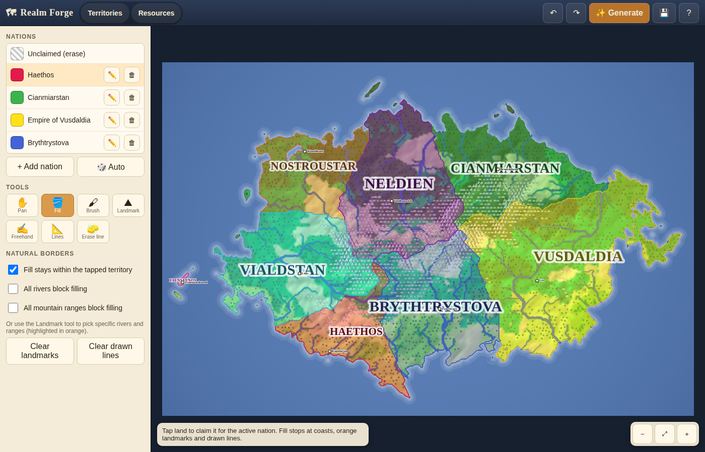

# Realm Forge – Fantasy Map Generator

A fantasy world-map generator and editor inspired by [Azgaar's Fantasy Map Generator](https://azgaar.github.io/Fantasy-Map-Generator/).
It is a dependency-free web app (plain HTML, CSS and ES modules) that installs as a PWA, so the same code runs on
**iOS, iPadOS, macOS and Windows** with mouse, trackpad, touch and Apple Pencil input.



## Features

- **Procedural world generation** – seeded heightmap with ridged mountains, coastal detail, depression filling,
  flow-accumulated rivers, climate-driven biomes, hillshading and hand-drawn style relief glyphs
  (mountains, hills, forests, wetlands, dunes). Templates: continent, pangea, islands, archipelago.
- **Nations** – auto-placed nations with capitals and towns, generated names, colours and labels.
  Add, rename, recolour and delete nations at any time.
- **Territory editing** (Territories mode)
  - **Fill** – tap land to claim a region for the active nation. The fill stops at the coast, at any selected
    natural landmark, and at any boundary you have drawn.
  - **Landmark** – tap a river or a mountain range to toggle it as a natural border (highlighted in orange).
    Checkboxes can make *all* rivers or *all* ranges act as borders.
  - **Freehand** – drag to draw a boundary line.
  - **Lines** – tap points to draw straight boundary segments; double-tap or press *Finish* to end,
    tap the first point to close a loop.
  - **Brush** – paint territory directly. **Erase line** removes a drawn boundary.
- **Resource layer** (Resources mode) – a toggleable overlay with adjustable opacity
  - **Pen** with 12 preset colours plus a custom colour picker and adjustable width.
  - **Shapes** – circle, square, triangle, diamond, star, hexagon, cross, ring, pentagon, drop – in any colour and size.
  - **Eraser** – tap or drag over drawings to remove them.
- Pan/zoom with two fingers, pinch, scroll wheel, trackpad or the Pan tool. Undo/redo for every edit.
- Autosaves in the browser; save/load `.json` map files to move between devices; export the map as a PNG.
- Works offline once installed (service worker).

## Running it

It is a static site, so any web server works:

```bash
# from the repository root
python3 -m http.server 8080
# or
npx serve .
```

Then open <http://localhost:8080>. (Opening `index.html` directly from disk does not work in every
browser because ES modules require `http://` or `https://`.)

A GitHub Actions workflow (`.github/workflows/pages.yml`) deploys the app to GitHub Pages on every push to
`main`. Enable *Settings → Pages → Source: GitHub Actions* in the repository, and the map will be reachable at
`https://<user>.github.io/<repo>/` from any device.

## Installing as an app

| Platform | How |
| --- | --- |
| iPhone / iPad (Safari) | Open the site, tap **Share → Add to Home Screen**. |
| macOS (Safari 17+) | **File → Add to Dock**. In Chrome/Edge use the install icon in the address bar. |
| Windows (Chrome/Edge) | Click the install icon in the address bar, or **⋯ → Apps → Install this site as an app**. |

## Controls

| Action | Mouse / trackpad | Touch |
| --- | --- | --- |
| Pan | Pan tool, right/middle drag, or hold Space | Two-finger drag, or Pan tool |
| Zoom | Scroll wheel / pinch on trackpad, `+` `-` keys | Pinch |
| Undo / redo | Ctrl/⌘+Z, Ctrl/⌘+Shift+Z | Toolbar buttons |
| Finish / cancel a straight line | Enter / Esc | *Finish* / *Cancel* buttons |

## Project layout

```
index.html            app shell and dialogs
css/style.css         responsive layout (sidebar on desktop, bottom sheet on phones)
js/app.js             UI wiring, pointer input, view, rendering loop
js/state.js           state model and editing operations (fill, brush, boundaries, resources, undo)
js/terrain.js         heightmap, drainage, rivers, biomes, ranges, auto nations
js/render.js          Azgaar-style rendering of terrain, nations, labels and overlays
js/contour.js         marching squares → smooth coastlines and borders
js/noise.js, rng.js   seeded noise and random numbers
js/names.js           name generator
js/storage.js         save / load / autosave
manifest.webmanifest, sw.js, icons/   PWA support
```

## Testing

`npx playwright` with the bundled Chromium is enough to exercise the app headlessly, for example:

```bash
npx http-server -p 8123 -s . &
node scripts/smoke.mjs   # generates a world, uses every tool, reloads, and screenshots
```
